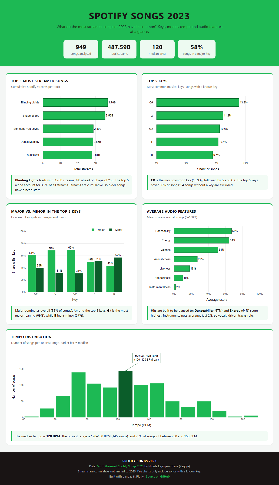

# Spotify Songs 2023 – Data Analysis


## Preview



*Interactive version: [`dashboard/spotify_dashboard.html`](dashboard/spotify_dashboard.html) (open in a browser) · Full-page PDF: [`docs/spotify_dashboard.pdf`](docs/spotify_dashboard.pdf)*

Analysis of the **Most Streamed Spotify Songs 2023** dataset from Kaggle.

The goal of this project is to explore and visualize characteristics of Spotify's most streamed songs in 2023, with a focus on musical and audio-related features such as **Key, Mode, BPM, Danceability, Energy** and other song attributes.

## Dataset

The dataset used in this project is:

**Most Streamed Spotify Songs 2023**
Created by **Nidula Elgiriyewithana**

[View the dataset on Kaggle](https://www.kaggle.com/datasets/nelgiriyewithana/top-spotify-songs-2023)

The dataset contains **953 songs and 24 variables**, including information about:

- Track and artist
- Release date
- Spotify streams
- Spotify playlists and charts
- Apple Music playlists and charts
- Deezer playlists and charts
- Song characteristics and audio features
- Key and mode
- BPM / tempo
- Danceability
- Energy
- Valence
- Acousticness
- Instrumentalness
- Liveness
- Speechiness

## Project Structure

```text
spotify-analysis/
├── data/
│   ├── README.md                            # how to get the data
│   ├── raw/spotify-2023.csv                 # Kaggle export, not in the repo
│   └── processed/spotify-2023-cleaned.csv   # created by scripts/clean_data.py, not in the repo
├── notebooks/
│   ├── 01_exploration.ipynb
│   ├── 02_cleaning.ipynb
│   ├── 03_exploratory_analysis.ipynb
│   └── 04_visualization.ipynb
├── src/spotify_analysis/
│   ├── data.py                              # loading + cleaning
│   ├── charts.py                            # Plotly charts + insights
│   └── report.py                            # HTML dashboard (header, KPIs, footer)
├── scripts/
│   ├── clean_data.py                        # raw data -> cleaned CSV
│   └── build_dashboard.py                   # build the dashboard HTML
├── dashboard/
│   ├── spotify_dashboard.ipynb
│   └── spotify_dashboard.html               # standalone version
├── docs/
│   ├── images/spotify_screen.png
│   └── spotify_dashboard.pdf          # full-page dashboard as PDF
├── requirements.txt
└── README.md
```

## Setup

```bash
pip install -r requirements.txt
# download spotify-2023.csv from Kaggle to data/raw/ (see data/README.md)
python scripts/clean_data.py        # recreate data/processed/
python scripts/build_dashboard.py   # dashboard/spotify_dashboard.html
```

## Data Quality

The cleaning step (`src/spotify_analysis/data.py`) handles the following problems in the raw data:

- `streams` is stored as text; one row (*Love Grows (Where My Rosemary Goes)*) contains shifted column values instead of a stream count and becomes `NaN`.
- `in_deezer_playlists` and `in_shazam_charts` contain thousands separators and are converted to numbers.
- 95 songs have no `key`; they are labelled `Unknown` and left out of the key analyses.
- 4 track/artist pairs appear twice (953 → 949 rows); the row with the most streams is kept.
- Special characters were already corrupted in the Kaggle export (`Taylor’s Version` → `Taylor��s Version`) and cannot be reconstructed.

## Status

This project is under active development. Data cleaning and exploratory analysis are done; the dashboard (header with KPIs, five charts with data-driven insights, footer) covers top streamed songs, top keys, major/minor split, average audio features and the BPM distribution.
